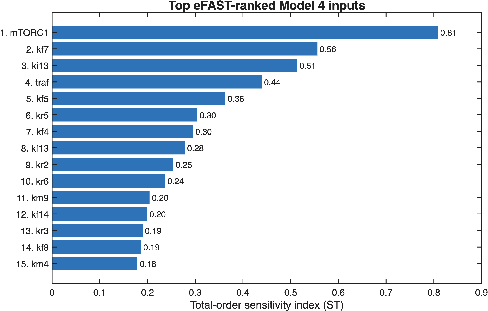
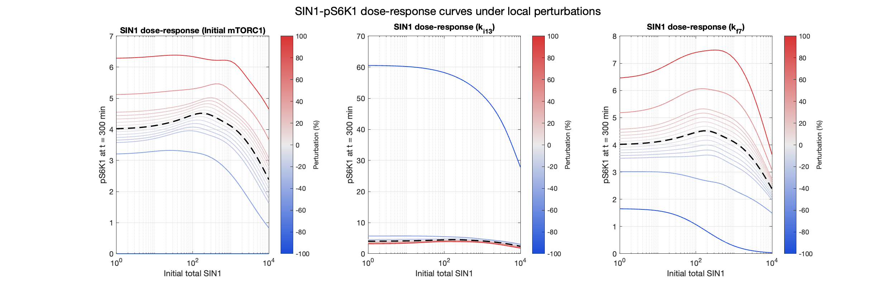

# Sensitivity Analysis of Biphasic SIN1 Regulation in the PI3K/AKT/mTOR Network

Course project for USC BME 530 (Spring 2026), by Hanyi Wang, Yiping Jia and Cecilia Liu.
Full write-up: [`project_report.pdf`](project_report.pdf).

## Question

Ghomlaghi et al. (*PLoS Comput Biol* 2021) built an ODE model of PI3K/mTOR signaling (Model 4).
It predicts a **biphasic** link between SIN1 and mTORC1 activity: more SIN1 first raises pS6K1, then
lowers it, because SIN1 (mTORC2) and Raptor (mTORC1) compete for the shared subunit mLST8.
We asked **which parameters and initial conditions control this biphasic response, and how robust it is**.

## Model

- A MATLAB reconstruction of Model 4 from the published model file (`paper_model_parameter/Model4.txtbc`)
- 22 state variables, 14 reactions (mass-action and Michaelis–Menten) and 43 kinetic parameters
- Baseline parameters: the best-fit row (minimum objective value) of `ParameterSets.xlsx`, sheet `Model 4`
- Solver: `ode15s` with RelTol 1e-8, AbsTol 1e-10, and non-negative states
- Readout: pS6K1 (mTORC1 activity) and pAKT-S473 (mTORC2 activity)
- **Biphasic Index (BI)**: initial SIN1 is swept from 0.01× to 100× baseline. The SIN1–pS6K1 curve is
  normalized to its peak, and `BI = (b − a) / (b + a)`, where `a` and `b` are the gaps from the peak to the
  lowest-SIN1 and highest-SIN1 ends of the curve.

See [`model4/MODEL4_SUMMARY.md`](model4/MODEL4_SUMMARY.md) for the state and reaction tables.

## Methods

1. **Baseline and SIN1 sweep.** We simulate the insulin response and sweep SIN1 over 61 log-spaced
   points to confirm the non-monotonic SIN1–pS6K1 curve.
2. **Global sensitivity analysis (eFAST).** 51 inputs (43 parameters and the 8 initial conditions that are
   positive at baseline) are each sampled on a log scale over 0.1×–10× baseline, with 129 samples per factor.
   That gives **6,579 parameter configurations**, each run through a full SIN1 sweep to compute BI.
   Inputs are ranked by their total-order index S_Ti.
3. **Local perturbation.** The top three inputs (initial mTORC1, kf7, ki13) are each changed by
   ±1, 5, 10, 15, 20, 25, 50 and 100% under sustained 100 nM insulin (0–300 min). For each change we
   record the pS6K1 time course, the 300-min pS6K1 and pAKT-S473 values, and BI from a 41-point SIN1 sweep.

## Key findings

- **BI depends strongly on parameters.** BI was computed for all 6,579 samples. Mean −0.494, median −0.499,
  range −1.000 to 0.972, IQR −0.926 to −0.125. 92.0% of samples had negative BI.
- **Sensitivity is spread across coupled modules, not SIN1 alone.** The top inputs by S_Ti were initial
  mTORC1 (0.808), kf7 (Akt phosphorylation, 0.556), ki13 (TSC2 inhibition of mTORC1, 0.514), traf
  (mLST8 trafficking, 0.439), kf5 (0.363) and kr5 (0.304). 25 of the 51 inputs had S_Ti ≥ 0.10.
- **The top factors play different roles:**
  - the mTORC1 pool sets the response amplitude (pS6K1 3.264 at −50% and 6.340 at +100%, vs 4.463 at baseline)
  - kf7 scales signal throughput (pS6K1 1.073 → 7.399 from −100% to +100%) while the curve keeps its peaked shape
  - higher ki13 lowers pS6K1 (5.494 → 3.870) even as pAKT-S473 rises (0.673 → 0.994), so mTORC1 output
    decouples from Akt activation
- **Limitations.** The analysis uses one best-fit parameter set and a modest eFAST sample size. The top
  input is an initial condition, which points to practical non-identifiability. The model is better at
  identifying the dominant regulatory modules than at ranking individual rate constants precisely.

| eFAST ranking | Local perturbation: SIN1 dose–response |
| --- | --- |
|  |  |

## References

- Ghomlaghi M, Yang G, Shin S-Y, James DE, Nguyen LK. Dynamic modelling of the PI3K/MTOR signalling network
  uncovers biphasic dependence of mTORC1 activity on the mTORC2 subunit SIN1. *PLoS Comput Biol* 2021;17(9):e1008513.
- Saltelli A, Tarantola S, Chan KPS. A quantitative model-independent method for global sensitivity analysis
  of model output. *Technometrics* 1999;41(1):39–56.
- Marino S, Hogue IB, Ray CJ, Kirschner DE. A methodology for performing global uncertainty and sensitivity
  analysis in systems biology. *J Theor Biol* 2008;254(1):178–196.
